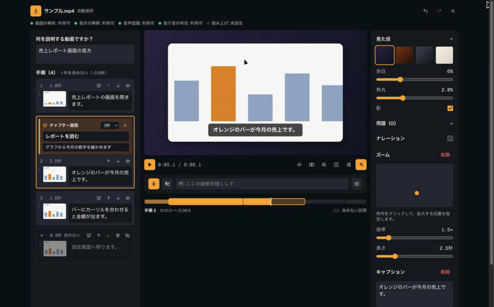
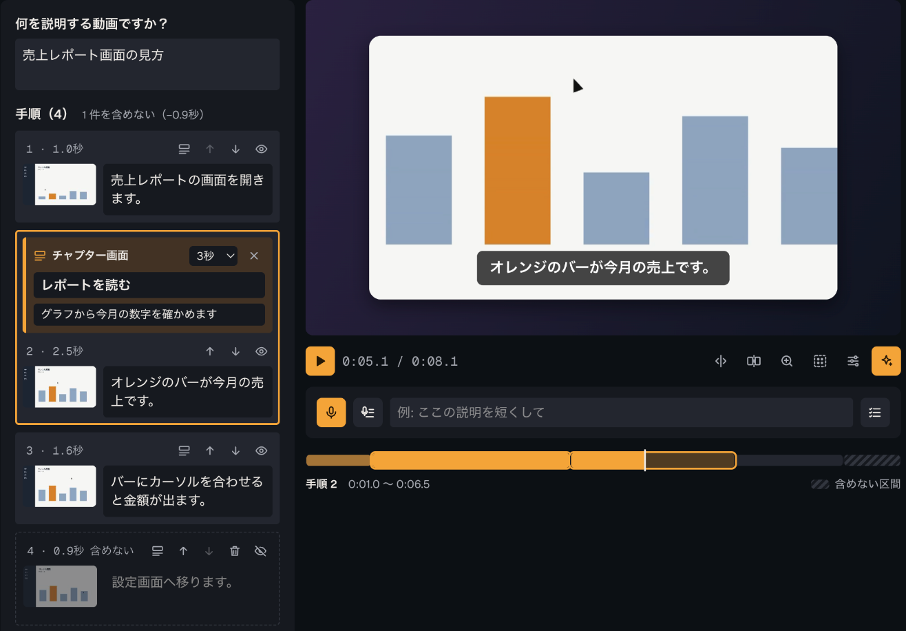
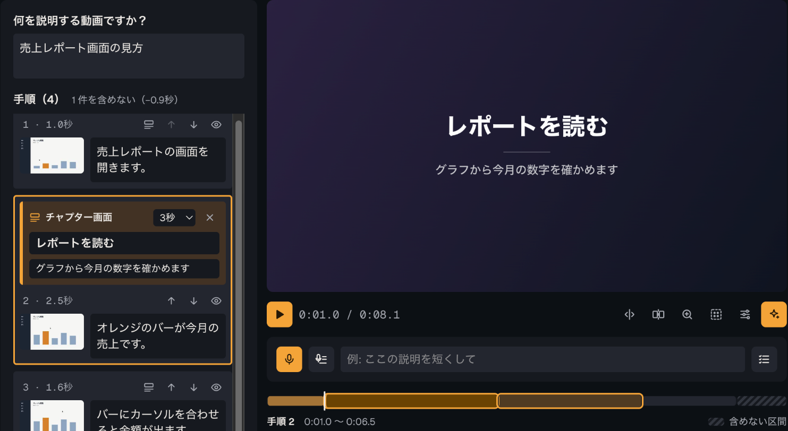

# Demovie

ソフトウェアの紹介や PC の操作説明の動画づくりを、生成 AI で手伝うブラウザアプリです。動画編集の知識は必要ありません。録画すると AI が操作の手順と説明文を下書きするので、担当者は文章を直すだけで動画を仕上げられます。

動画はブラウザの中で処理します。独り言の判定を有効にすると、音声を文字にした内容だけが外部のサービスへ送られます。AI による手順の作成を使うと、フレーム画像が設定した VLM サーバへ送られます。既定の接続先は同じ PC の `127.0.0.1` です。

> モザイクと黒塗りは書き出した動画だけにかかります。ブラウザに保存された元の録画は変更しません。



> 開発中の MVP です。編集内容は使用中のブラウザに自動保存されます。シークレットウィンドウを閉じたり、サイトデータを消去したりすると失われるので、残しておきたい作業は「フォルダに保存」でフォルダにも保存してください。

## 紹介動画

Demovie で作った、Demovie 自身の紹介動画です（2 分 32 秒、ナレーション付き）。録画の読み込みから、AI による手順の下書き、説明文の修正、書き出し、フォルダへの保存までを一通り紹介しています。

<!-- ここに、GitHub の Web 画面で貼り付けた紹介動画の URL（https://github.com/user-attachments/assets/...）を 1 行で置く -->

ナレーションの音声は VOICEVOX:春日部つむぎ です。

## 機能

- 画面録画、動画ファイルの読み込み、サンプル動画の生成
- 複数の録画を取り込み、1 本の説明動画につなげる機能（開始画面でまとめて選ぶか、編集中に「動画を追加」）
- 動画の目的を手がかりにした、VLM による手順と説明文の自動作成
- サムネイル付きの手順の一覧での説明文の修正、並べ替え、映像ごとの削除
- 手順を「動画に含めない」に切り替えて、削除する前に仕上がりを確かめる機能
- 手順の前に、チャプター名と補足を映すチャプター画面を差し込む機能
- 手順と含めない区間を色分けした再生バーと、長い動画で再生位置の近くを拡大したバー
- 画面の変化した位置へのズームの自動提案と、倍率、中心、長さの調整
- 背景、余白、角丸、影の調整
- 機密情報を隠すモザイクと黒塗り（書き出す動画に焼き込み、ズーム中も追従）
- 音声または文字での指示による編集（説明文の書き換え、手順の削除や移動、ズーム、背景など）
- 「保存ボタンにズームして」のように、画面の部品を名指ししたズーム
- 再生しながら話した説明を、整えて手順の説明文にする機能
- 動画を通して見ながら指示を話し、終わってからまとめて確認して適用する機能
- 必要なときだけ開けるタイムラインでの微調整
- [VOICEVOX](https://voicevox.hiroshiba.jp/) による説明文の読み上げ（ナレーション）
- 編集内容の自動保存と、続きからの再開
- 作業と使った動画をフォルダにまとめて保存し、あとから開き直して編集する機能（デスクトップ版の Chrome / Edge）
- AI の接続状況の表示（画像を扱えないモデルが動いている場合も検出）
- 社内システム名などの用語の登録
- 1920×1080、30fps の動画書き出し（MP4。ブラウザが対応していなければ WebM）。ナレーションと録画の音を入れるかは書き出すときに選べます

## 画面

録画を読み込むと、AI が手順に分けて説明文を下書きします。左の一覧で説明文を直し、使わない手順は目のアイコンで動画から外します。



手順の見出しアイコンから、操作のまとまりごとにチャプター画面を差し込めます。



複数の録画を 1 本の説明動画にまとめられます。開始画面の「動画を読み込む」でまとめて選ぶと名前順に並び、編集中はヘッダーの「動画を追加」で末尾に足せます。足した動画にも、説明文やチャプター画面を付けられます。

## 作業をフォルダに保存する

ヘッダーの「フォルダに保存」で、作業データと使っている動画を 1 つのフォルダにまとめて保存します。動画ファイルと一緒に手元へ残しておけば、ブラウザのデータを消したあとや別の PC でも、開始画面の「フォルダから開く」で続きから編集できます。デスクトップ版の Chrome と Edge で使えます。

```
<保存したフォルダ>/
  project.json        手順、説明文、チャプター、ズーム、見た目、ナレーションの設定
  videos/01_xxx.mp4   使っている動画（並び順と元のファイル名から名前を付けます）
```

- 初めて保存するときは、空のフォルダを選びます。ほかのファイルがあるフォルダや、別の作業を保存したフォルダには保存しません。
- 2 回目からは同じフォルダに上書きします。ヘッダーに「保存済み」か「未保存の変更あり」が出ます。「保存先を変える」で別のフォルダにも保存できます。
- 動画は変わっていなければ書き直さないので、上書き保存はすぐ終わります。
- フォルダから開いたとき、ブラウザに同じ作業のより新しい変更が残っていれば、上書きせずに別の作業として開きます。
- 右パネルの「用語」はブラウザごとの設定なので、フォルダには入りません。

## 必要なもの

- Node.js 20.9 以上
- デスクトップ版の Chrome または Edge
- AI の機能を使う場合は、[llama.cpp](https://github.com/ggml-org/llama.cpp) の `llama-server`（下記の各節を参照）

## セットアップ

```bash
npm install
npm run dev
```

http://localhost:3000 を開きます。

画面録画は `localhost` か HTTPS で開いたときだけ使えます。

### AI による手順の作成

画像入力に対応したモデルと、対応する mmproj ファイルで `llama-server` を起動します。既定の接続先は `http://127.0.0.1:8084` です。

```bash
llama-server -m <model>.gguf --mmproj <mmproj>.gguf --host 127.0.0.1 --port 8084
```

接続先を変える場合は、`.env.local` に次のように指定します。

```bash
NEXT_PUBLIC_VISION_URL=http://127.0.0.1:8084
```

外部のサーバを指定すると、動画のフレーム画像がそのサーバへ送信されます。ブラウザから直接呼び出すため、サーバ側で CORS の許可も必要です。

生成される説明文はモデルの推測を含みます。書き出す前に内容を確認してください。

### 音声と文字による指示

文字の指示には、JSON スキーマ付きの応答に対応したテキストモデルを動かす `llama-server` を使います。音声の指示には、さらに [whisper.cpp](https://github.com/ggml-org/whisper.cpp) の `whisper-server` も使います。AI が返すのは編集操作の一覧だけで、アプリが検証してから実行します。

| 用途 | 既定の接続先 | 環境変数 |
|---|---|---|
| 指示の解釈 | `http://127.0.0.1:8080` | `NEXT_PUBLIC_LLM_URL` |
| 音声認識 | `http://127.0.0.1:8090` | `NEXT_PUBLIC_WHISPER_URL` |

外部のサーバを指定すると、音声や指示の内容、説明文がそのサーバへ送信されます。

音声認識のサーバが止まっている間は、「押して指示」「説明文を話す」「通しで確認」は使えません。文字での指示は使えます。

「説明文を話す」は、話し始めた時点の手順の説明文を置き換えます。音声は Whisper で文字にし、`llama-server` でつなぎ言葉を除いて整えます。整えられないときは話した言葉のまま入れます。

右パネルの「用語」に、社内システム名などを 1 行に 1 語で登録できます。読みが表記と離れている語は `Demovie = デモービー` のように書きます。音声の指示と説明文、AI による手順の作成、ナレーションの読みに使い、ブラウザに保存します。作業のフォルダには入らないので、別のブラウザで開くときは登録し直してください。用語は Jev へ送信しません。

### 独り言の判定（任意）

音声の指示は、編集 AI に渡す前に [TypeSafe の Jev](https://docs.typesafe.ai) で、編集の指示か独り言かを判定できます。使う場合は `.env.local` にサーバ側の API キーを設定します。`NEXT_PUBLIC_` は付けないでください。

```bash
TYPESAFE_API_KEY=<API キー>
```

設定すると、**音声を文字にした内容が TypeSafe へ送信されます**。動画、音声そのもの、説明文は送信しません。キーがないときや判定に失敗したときは判定を省略し、指示として扱います。

雑談と判定された発話は実行せず、「指示として実行」で実行し直せます。文字で入力した指示と、AI の聞き返しへの返事は判定しません。

`/api/intent` は、同じポートの `localhost` からの呼び出しだけを受け付けます。別のドメインで動かす場合は `APP_ORIGIN=https://example.com` を設定してください。設定すると、そのオリジンだけを受け付けます。ただし、このルートにユーザー認証とレート制限はありません。API キーを設定したまま外部に公開する場合は、認証とレート制限も追加してください。

### ナレーション（任意）

[VOICEVOX](https://voicevox.hiroshiba.jp/) のエンジンで説明文を読み上げます。アプリか Docker で起動してください。既定の接続先は `http://127.0.0.1:50021` で、`NEXT_PUBLIC_VOICEVOX_URL` で変更できます。

```bash
docker run --rm -p 127.0.0.1:50021:50021 voicevox/voicevox_engine:cpu-latest
```

チャプター画面では、チャプター名と補足を続けて読み上げます。読み上げが手順より長いときは、最後の画面で止めて読み終わるのを待つので、動画はその分長くなります。「ナレーション付きで再生」で、書き出す前に間合いを確認できます。

VOICEVOX の音声には**クレジット表記が必要**です。ナレーションを有効にすると、動画の右下に「VOICEVOX:声の名前」を表示します。声ごとに利用規約があるので、使う前に確認してください。

## 開発

```bash
npm run typecheck
npm run lint
npm test
```

PR と `main` への push では、GitHub Actions が同じ確認と本番ビルドを実行します。

## 謝辞

Demovie の開発では、[OpenScreen](https://github.com/getopenscreen/openscreen) の機能やコンセプトを参考にしました。録画をデモ動画に仕上げるという体験を、オープンソースとして公開している OpenScreen の作者と貢献者のみなさんに感謝します。

Demovie は独立したプロジェクトです。OpenScreen のコードや素材は使用しておらず、OpenScreen プロジェクトとは関係がありません。OpenScreen の公式プロジェクトや派生版ではなく、同プロジェクトから承認を受けたものでもありません。Demovie に関するお問い合わせを OpenScreen プロジェクトへ送らないようお願いします。

## ライセンス

[MIT License](./LICENSE)
